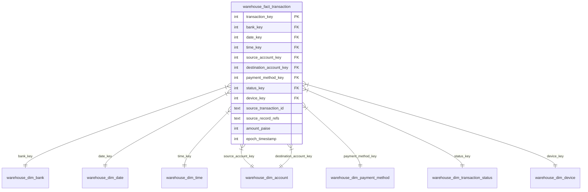

# BankFusion: Database Schema & Star Schema Data Dictionary

## 1. Database Architecture
BankFusion uses **SQLite** with explicit table name prefixes to separate source staging tables, the Kimball star-schema data warehouse, audit ledgers, and isolated evaluation datasets:

* `bank_a_*`: Conventional retail banking source tables.
* `bank_b_*`: Digital wallet event source tables.
* `bank_c_*`: Double-entry accounting ledger source tables.
* `warehouse_dim_*`: Conformed analytical dimension tables.
* `warehouse_fact_*`: Central analytical fact table.
* `etl_*`: Audit logs and rejection quarantine tables.
* `fraud_*`: Detection execution runs, entity warnings, and universal predictions.
* `evaluation_*`: Separate ground-truth scenario labels.

---

## 2. Source Layer Schema

### `bank_a_transactions`
| Column | Data Type | Constraints | Description |
|---|---|---|---|
| `transaction_id` | TEXT | PRIMARY KEY | Unique transaction reference (e.g., `A-TXN-00001`) |
| `transaction_timestamp` | TEXT | NOT NULL | ISO-8601 IST string (`+05:30`) |
| `sender_account_ref` | TEXT | NOT NULL | Sending account (e.g., `A-ACC-0001`) |
| `receiver_account_ref` | TEXT | NOT NULL | Receiving account |
| `receiver_bank_code` | TEXT | NOT NULL | Destination bank (`BANK_A`, `BANK_B`, `BANK_C`) |
| `amount_paise` | INTEGER | NOT NULL, CHECK(> 0) | Monetary transfer in integer paise |
| `payment_mode` | TEXT | NOT NULL | `UPI`, `IMPS`, `NEFT`, `RTGS`, `CARD` |
| `transaction_status` | TEXT | NOT NULL | `SUCCESS`, `FAILED`, `PENDING` |
| `device_token` | TEXT | NULLABLE | Synthetic hardware token (e.g., `SIM-DEVICE-001`) |

### `bank_b_events`
| Column | Data Type | Constraints | Description |
|---|---|---|---|
| `event_id` | TEXT | PRIMARY KEY | Unique event reference (e.g., `B-EVT-00001`) |
| `payment_request_ref` | TEXT | NOT NULL | Intent identifier binding retry attempts |
| `event_timestamp` | TEXT | NOT NULL | ISO-8601 IST string |
| `sender_wallet_ref` | TEXT | NOT NULL | Sending wallet account (e.g., `B-ACC-0001`) |
| `beneficiary_account_ref` | TEXT | NOT NULL | Beneficiary account |
| `beneficiary_bank_code` | TEXT | NOT NULL | Destination bank code |
| `value_paise` | INTEGER | NOT NULL, CHECK(> 0) | Transfer value in integer paise |
| `channel_code` | TEXT | NOT NULL | `WALLET_TRANSFER`, `QR_SCAN`, `UPI_DIRECT` |
| `result_code` | TEXT | NOT NULL | `RC_00_SUCCESS`, `RC_05_FAILED`, `RC_99_PENDING` |
| `device_token` | TEXT | NULLABLE | Synthetic hardware token |

### `bank_c_ledger_entries`
| Column | Data Type | Constraints | Description |
|---|---|---|---|
| `entry_id` | TEXT | PRIMARY KEY | Unique ledger entry reference (e.g., `C-E-00001`) |
| `journal_id` | TEXT | NOT NULL | Journal identifier connecting paired legs |
| `posting_timestamp` | TEXT | NOT NULL | ISO-8601 IST string |
| `ledger_account_ref` | TEXT | NOT NULL | Posting account for this leg |
| `counterparty_account_ref`| TEXT | NOT NULL | Reciprocal counterparty account |
| `counterparty_bank_code` | TEXT | NOT NULL, DEFAULT 'BANK_C' | Counterparty bank code |
| `entry_side` | TEXT | NOT NULL, CHECK IN ('DEBIT', 'CREDIT') | Side of entry leg |
| `amount_paise` | INTEGER | NOT NULL, CHECK(> 0) | Entry amount in integer paise |
| `currency` | TEXT | NOT NULL, DEFAULT 'INR' | Currency code |
| `transfer_type` | TEXT | NOT NULL | `BOOK_TRANSFER`, `INTERNAL_LEDGER_TRANSFER` |
| `entry_status` | TEXT | NOT NULL | `POSTED`, `UNPOSTED`, `REJECTED` |
| `device_token` | TEXT | NULLABLE | Synthetic hardware token |

---

## 3. Kimball Star Schema Data Warehouse

### `warehouse_fact_transaction`
* **Grain:** Exactly one normalized payment attempt (Banks A & B) or one valid posted transfer represented by a Bank C journal pair.
* **Idempotency:** Composite unique constraint on `(bank_key, source_transaction_id)`.
* **Lineage:** Preserves `source_transaction_id` and dual entry references in `source_record_refs` (e.g. `"C-E-001,C-E-002"`).

### Dimensions Summary
1. **`warehouse_dim_bank`:** 3 conformed bank members (`BANK_A`, `BANK_B`, `BANK_C`).
2. **`warehouse_dim_account`:** Composite unique constraint `UNIQUE(bank_key, source_account_ref)`.
3. **`warehouse_dim_date`:** Date keys formatted as integer `YYYYMMDD`, tracking full date, month, quarter, year, and weekend status.
4. **`warehouse_dim_time`:** Pre-populated 1,440 minute records (24 hours $\times$ 60 minutes) tracking hour, minute, and time of day.
5. **`warehouse_dim_payment_method`:** Canonical methods (`UPI`, `IMPS`, `NEFT`, `RTGS`, `CARD`, `WALLET`, `BOOK_TRANSFER`).
6. **`warehouse_dim_transaction_status`:** Conformed terminal statuses (`SUCCESS`, `FAILED`, `PENDING`).
7. **`warehouse_dim_device`:** Physical hardware tokens. Contains surrogate member `device_key = 1` for `UNKNOWN_DEVICE`.

---

## 4. Audit & Evaluation Schema

* **`etl_batch_log`:** Stores batch execution history, physical bank-wise extracted/valid/rejected row counts, and integer paise monetary decompositions.
* **`etl_rejected_record`:** Quarantined rows containing failure stage (`VALIDATE`, `PAIRING`), rejection reason, and raw payload.
* **`fraud_detection_run`:** Tracks detection run executions, evaluated counts, and run duration.
* **`fraud_screening_warning`:** High-level entity warnings for investigators (`VELOCITY_BURST`, `SHARED_DEVICE`).
* **`fraud_transaction_prediction`:** Universal transaction predictions (`flagged_by_velocity`, `flagged_by_device`, `is_predicted_suspicious`).
* **`evaluation_ground_truth`:** Logically separated ground-truth scenario labels accessed strictly for post-detection metric calculations.

