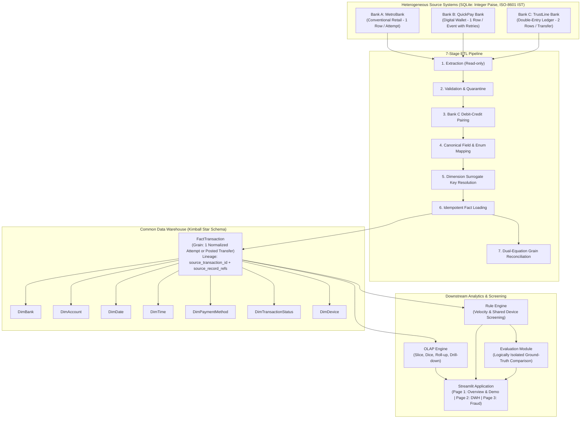

# BankFusion: Project Architecture & Technical Design

## 1. System Overview
**BankFusion** is an academic Data Warehousing and Data Mining (DWM) platform developed for intermediate Computer Science students. It simulates three heterogeneous commercial banking source systems, extracts and standardizes their records via a 7-stage ETL pipeline, loads them into an idempotent Kimball-style star schema data warehouse, executes multidimensional OLAP queries, and applies deterministic, explainable fraud-screening rules with logically separated ground-truth evaluation.

---

## 2. Source System Heterogeneity & Grain Differences

To avoid artificial replication, the three banks embody fundamentally different operational philosophies:

| Dimension | Bank A (MetroBank) | Bank B (QuickPay Bank) | Bank C (TrustLine Bank) |
|---|---|---|---|
| **Banking Type** | Traditional Retail Core | Digital Payments & Wallets | Double-Entry Accounting Ledger |
| **Operational Model** | Flat transaction-per-attempt | Event stream with retries | Reciprocal debit-credit postings |
| **Source Grain** | 1 row = 1 payment attempt | 1 row = 1 payment event | 2 rows = 1 business transfer |
| **Primary Identifier** | `transaction_id` | `event_id` (grouped by `payment_request_ref`) | `entry_id` (grouped by `journal_id`) |
| **Monetary Storage** | `amount_paise INTEGER` | `value_paise INTEGER` | `amount_paise INTEGER` |
| **Failure Representation** | `transaction_status = 'FAILED'` | `result_code = 'RC_05_FAILED'` | Non-POSTED status or unpaired legs |

---

## 3. Bank C Debit-Credit Pairing Rule

Bank C's grain differs from Banks A and B. During ETL Stage 3:
1. Entries are grouped by `journal_id`.
2. The engine asserts that the journal contains **exactly one `DEBIT` leg and one `CREDIT` leg**.
3. It asserts that `debit.amount_paise == credit.amount_paise`.
4. It asserts reciprocal counterparty validation:
   $$\text{debit.counterparty\_account\_ref} == \text{credit.ledger\_account\_ref}$$
   $$\text{credit.counterparty\_account\_ref} == \text{debit.ledger\_account\_ref}$$
5. Both legs must be in `POSTED` status.
6. The debit account is assigned as the sender; the credit account is assigned as the receiver.
7. Exactly **one normalized fact row** is emitted per valid journal.
8. **Lineage:** `FactTransaction.source_transaction_id` stores `journal_id`, and `source_record_refs` stores both entry IDs (e.g. `"C-E-001,C-E-002"`).
9. Malformed or unbalanced journals are quarantined to `etl_rejected_record`.

---

## 4. Dual-Equation Grain-Aware Reconciliation

Because Bank C entries represent individual legs rather than standalone transfers, the reconciliation engine enforces two mathematically distinct balance equations:

### Equation 1: Source Row Extraction Balance
$$\text{Total Source Rows Extracted} = \text{Total Valid Source Rows} + \text{Total Rejected Source Rows}$$

Where:
$$\text{Total Extracted} = N_{\text{Bank\_A}} + N_{\text{Bank\_B}} + N_{\text{Bank\_C\_entries}}$$
$$\text{Bank C Valid Journals} = \frac{1}{2} \times \text{Bank C Valid Entries}$$

### Equation 2: Normalized Warehouse Transaction Balance
$$\text{Normalized Transactions Produced} = \text{Warehouse Rows Inserted} + \text{Duplicate Rows Skipped}$$

Where:
$$\text{Normalized Produced} = N_{\text{Valid\_Bank\_A}} + N_{\text{Valid\_Bank\_B}} + \text{Bank C Valid Journals}$$

### Complete Monetary Decomposition (Integer Paise)
$$\text{Normalized Amount Produced} = \text{Newly Inserted Amount} + \text{Duplicate Skipped Amount}$$
$$\text{Newly Inserted Amount} = \text{Successful Amount}_{\text{ins}} + \text{Failed Amount}_{\text{ins}} + \text{Pending Amount}_{\text{ins}}$$
$$\text{Duplicate Skipped Amount} = \text{Successful Amount}_{\text{skp}} + \text{Failed Amount}_{\text{skp}} + \text{Pending Amount}_{\text{skp}}$$

---

## 5. Fraud Screening Rules & Ground-Truth Separation

### Rule 1: Transaction Velocity
* **Objective:** Detect automated burst payments or rapid attempt frequency.
* **Condition:** $\ge 4$ payment attempts by the same source account within an inclusive rolling 300-second window ($t_1 \le t \le t_1 + 300\text{s}$).
* **Scope:** Evaluates all attempts (including failed) for Banks A and B; evaluates valid posted transfers for Bank C.

### Rule 2: Shared-Device Usage
* **Objective:** Identify hardware multiplexing across accounts.
* **Condition:** $\ge 3$ distinct sending accounts using the same `device_token` within an inclusive rolling 86,400-second (24 hours) window.
* **Exclusion:** The surrogate `UNKNOWN_DEVICE` is strictly excluded.

### Universal Transaction Predictions & Evaluation Boundary
* Every transaction in `FactTransaction` receives a prediction row in `fraud_transaction_prediction` (`flagged_by_velocity`, `flagged_by_device`, `is_predicted_suspicious`).
* Ground truth is stored in `evaluation_ground_truth` and accessed **only** inside `evaluate_detection_results.py` to calculate True Positives, False Positives, True Negatives, False Negatives, Precision, Recall, and F1.

